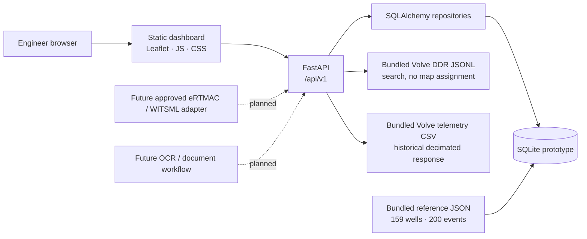

# eRTMAC-NWIS Architecture

## Scope and implementation status

This release is a single-process FastAPI application with a static browser dashboard and a local SQLite store. It is an SIH prototype built from the supplied reference archive. It does not connect to OIL systems, eRTMAC, a live WITSML feed, an identity provider, an OCR service, or a production predictive model.

Implemented: radius-based map queries, source-tagged well and event browsing, SQLite initialization and migration for the prior prototype schema, source DDR text search, historical telemetry visualization, deterministic upload text extraction, and transparent threshold-based risk screening. Planned integrations are identified as future work below.

## System context

## Components and responsibilities

| Component | Responsibility |
|---|---|
| `app/main.py` | FastAPI lifespan, database initialization, prototype-schema additive upgrade, one-time loading of the reference well/event JSON, static dashboard hosting. |
| `app/api/router.py` | Versioned HTTP endpoints, input validation, serialization, radius filtering, DDR search and telemetry decimation. |
| `app/db/models.py` | SQLAlchemy Well and Event persistence models, including provenance and synthetic-data flags. |
| `app/db/repositories.py` | Query/filter operations for wells and events. |
| `app/db/session.py` | Database engine/session and additive migration for fields added after the original six-well prototype. |
| `app/services/geospatial.py` | Great-circle distance calculation over WGS84 latitude/longitude. |
| `app/services/risk.py` | Explicit threshold rules and nearby event references; this is not a trained or calibrated model. |
| `app/services/ingestion.py` | Text/PDF text extraction and keyword event candidates; uploaded results are returned for review and not saved as authoritative events. |
| `app/data/reference/` | Curated, attributed seed data, DDR search archive and historical sensor CSV. See its README for provenance and known data limitations. |
| `app/static/` | Static interface: map, dashboard, event filtering, manual risk form, historical telemetry graph and DDR excerpt search. |

## Data flows

### Startup and structured reference data

1. SQLAlchemy creates missing tables. A small additive migration upgrades the earlier local prototype tables.
2. On startup, `wells.json` and `events.json` are imported idempotently by record ID. The six known synthetic wells from the original prototype are removed; all other existing well and event rows are preserved.
3. Subsequent startups keep database contents and add any missing reference records. Dataset corrections to existing IDs require a future explicit versioned import tool.

### Geospatial and event browsing

The browser loads the well and event lists, then calculates nearby wells around a focus well, entered coordinate pair, selected map point or device location using the Haversine approximation. The API also supports radius-filtered well queries for other clients. Choosing a nearby well makes it the new focus. Surface coordinates locate the well, not its downhole event depth. Synthetic control coordinates are visibly tagged and are not real locations.

### Source report search

`GET /api/v1/ddrs` scans the curated Volve DDR JSONL file by text and optional hazard. The upstream extraction uses the generic well key `NO` for these reports. Responses carry an attribution warning and are intentionally not connected to a mapped well, formation interval or offset radius.

### Historical telemetry

`GET /api/v1/telemetry` reads the bundled Volve F-9A telemetry file and returns a decimated sample with numeric values for a small channel set. The browser draws historical torque and rotary-speed trends and marks the archived 619 m incident reference. It is not streaming data and does not feed the prototype risk rules.

### Risk snapshot

The user-submitted numeric snapshot reaches `/api/v1/risks/assess`; schema constraints validate non-negative values where applicable. Rules in `app/services/risk.py` emit named indicators, scores and matched same-well records within 250 m. No model is trained, no probability is implied, and no operational action is sent.

## Persistence model

- **Well:** stable well ID, field label, WGS84 surface coordinates, total depth, source label, explicit synthetic flag, and serialized source metadata (trajectory, formations, casing and mud program where supplied).
- **Event:** well ID, measured depth in metres, hazard, severity, source event vocabulary ID, formation label, report date, NPT, lost volume, mud weight, extraction confidence, original text and source reference.
- **DDR archive:** JSONL reference records are searched directly; because source well attribution is unresolved, they are not inserted as well-linked events.
- **Telemetry:** source CSV is read-only bundled data; it is not persisted in SQLite or interpreted as a current stream.

The 200 structured records are synthetic. The 40 synthetic-control well locations and well attributes are synthetic. The 118 FORCE 2020 well records and single Volve well metadata record are source-labeled real reference records. Confidence scores describe the upstream extraction artifact and are not calibrated probabilities.

## API surface

All endpoints are under `/api/v1` and OpenAPI is available at `/docs`.

| Endpoint | Purpose |
|---|---|
| `GET /health` | Prototype health check |
| `GET /wells` | List wells or filter by center, radius and text query |
| `GET /wells/{well_id}` | Well metadata and structured events |
| `GET /events` | Search/filter structured well-linked events |
| `GET /analytics/summary` | Dataset totals and hazard distribution |
| `GET /ddrs?q=...` | Search unlocated Volve report excerpts |
| `GET /telemetry` | Decimated historical Volve F-9A trace |
| `POST /risks/assess` | Evaluate a manual parameter snapshot against transparent rules |
| `POST /documents/ingest` | Extract text and return candidate lines for manual review |

## Data quality and limitations

- The SIH source event extraction has 1,759 Volve-labeled rows but collapses well IDs to `NO`; this app retains 1,686 non-empty excerpts separately, without falsely assigning their locations.
- The structured 200-event corpus is explicitly synthetic, including its narratives, outcomes and severity labels.
- Source artifacts have inconsistent measured depths and occasional empty or placeholder values; the app preserves the extracted values and does not imply they are fully reconciled.
- The supplied telemetry is historical public reference data. The 619 m stuck-pipe incident is taken from a supplied backtest report, not independently verified by this prototype.
- Some upstream notes and performance claims describe other modules and analyses. They are not silently treated as capabilities or validated results of this implementation.
- The supplied archive has no single license file covering all redistributed data. See `app/data/reference/README.md` and check upstream terms before external redistribution.

## Production requirements and planned evolution

Before operational use, OIL must approve and provide identity/access control, data residency, secure network and secrets management, audit and retention policies, source contracts, well identity resolution, data validation, backups, deployment monitoring and incident response. Confirm coordinate systems, depth datum, units and source freshness.

Next architecture steps are: (1) resolve official OIL well keys and safely ingest OIL WCR/DDR/mud-log sources with provenance; (2) add a reviewed OCR/NLP extraction queue; (3) migrate to PostgreSQL/PostGIS with Alembic and spatial indexing; (4) integrate authenticated eRTMAC streams through a bounded adapter; (5) build labeled, leakage-audited validation and calibrated models; and (6) conduct field shadow testing and operator review before release. No automated rig control should be added.
